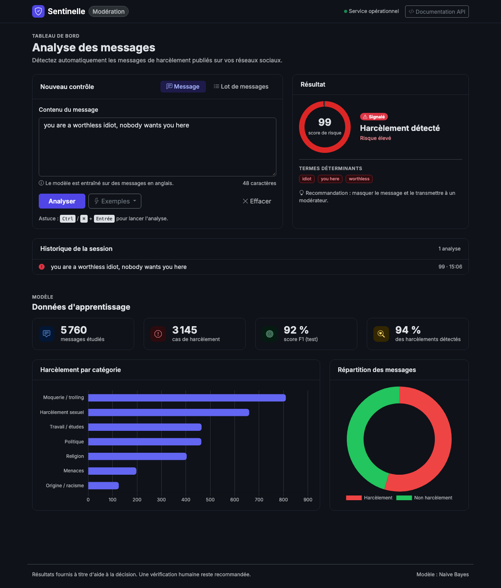

# Détection du harcèlement social (cyberbullying) – Test Data Science

### 🔗 Démo en ligne : **https://sentinelle-cyberbullying.onrender.com**

| | |
|---|---|
| **Tableau de bord** (client / modérateurs) | https://sentinelle-cyberbullying.onrender.com |
| **Documentation API** (développeurs) | https://sentinelle-cyberbullying.onrender.com/docs |
| **Hébergement** | Render (Docker, déploiement automatique à chaque push sur `main`) + MongoDB Atlas (M0, AWS Paris) |

> Offre gratuite : après 15 minutes sans visite, le service se met en veille. La première ouverture prend alors environ 50 secondes.



**Tout le projet est dans un seul notebook : [`cyberbullying_detection.ipynb`](cyberbullying_detection.ipynb)** (déjà exécuté, résultats et graphiques visibles directement).

| Section du notebook | Contenu |
|---|---|
| 1. Exploration et nettoyage | 19 orthographes du label → 2 classes, 24 types → 7, doublons et labels contradictoires supprimés (8 452 → 5 760 messages) |
| 2. MongoDB | chargement dans `cyberbullying.messages`, index, agrégations |
| 3. Analyse descriptive | classes, types de harcèlement, longueur, grossièretés, vocabulaire (données relues depuis MongoDB) |
| 4. Modélisation | Régression logistique vs Naive Bayes (TF-IDF), validation croisée 5 folds |
| 5. Étude comparative | métriques, test de McNemar, taux de détection par type |
| 6. Visualisations | matrices de confusion, ROC / Précision-Rappel, facteurs influents, analyse d'erreurs |
| 7. FastAPI + Docker | export du modèle, code de l'API, build et test du conteneur |
| 8. Conclusion | choix du modèle, limites, pistes |

Données : [Kaggle – Cyberbullying and Harassment Detection using ML](https://www.kaggle.com/datasets/saifulislam7/cyberbullying-and-harassment-detection-using-ml).

## Structure

```
DataScience_Exercise/
├── cyberbullying_detection.ipynb   # LE projet (étapes 1 → 8)
├── data/raw_cyberbullying.csv      # données brutes Kaggle
├── data/clean_cyberbullying.csv    # généré par le notebook
├── models/                         # modèle retenu + metadata.json (générés par le notebook)
├── figures/                        # graphiques (générés par le notebook)
├── api/                            # app.py, text_utils.py, requirements.txt + static/ (tableau de bord), générés par le notebook
├── Dockerfile
├── docker-compose.yml              # MongoDB + API
└── requirements.txt                # environnement du notebook
```

Le notebook écrit lui-même les fichiers de l'API (`%%writefile`) : il n'y a qu'une seule source de code.

## Exécuter le notebook

Prérequis : Python 3.12+ et Docker Desktop (lancé).

```bash
python3 -m venv .venv && source .venv/bin/activate
pip install -r requirements.txt
jupyter lab cyberbullying_detection.ipynb
```

Puis « Run All ». Le notebook démarre MongoDB (`docker compose up -d mongo`), entraîne les modèles, génère l'API, puis construit et teste le conteneur.

## Lancer uniquement l'API (déjà entraînée)

```bash
docker compose up -d --build
```

- **Tableau de bord pour le client / les modérateurs (« Sentinelle ») : http://localhost:8000/**. Il est construit avec Bootstrap 5.3, Bootstrap Icons et Chart.js, et s'adapte au mobile et au mode sombre. Il affiche un score de risque, le verdict, les termes déterminants et une recommandation d'action. On peut aussi analyser un lot de messages (avec export CSV), consulter l'historique de la session et voir les indicateurs et graphiques des données d'apprentissage. Des captures d'écran se trouvent dans `figures/ui_*.png` et dans la section 7.6 du notebook.
- Documentation technique Swagger (développeurs) : http://localhost:8000/docs
- MongoDB : `localhost:27017` (rempli automatiquement au premier démarrage de l'API s'il est vide)

| Endpoint | Méthode | Rôle |
|---|---|---|
| `/health` | GET | état de l'API, modèle chargé, connexion MongoDB |
| `/model` | GET | modèle retenu et métriques |
| `/predict` | POST | `{"text": "..."}` → label + probabilité |
| `/predict/batch` | POST | `{"texts": [...]}` (≤ 1000) |
| `/stats` | GET | répartition par classe / type (agrégations MongoDB) |

```bash
curl -X POST localhost:8000/predict -H "Content-Type: application/json" -d '{"text":"you are a worthless idiot"}'
```

Arrêt : `docker compose down` (ajouter `-v` pour supprimer les données Mongo).

## Déploiement

### En ligne : Render + MongoDB Atlas (gratuit)

Le fichier [`render.yaml`](render.yaml) décrit le service. Render construit le `Dockerfile` depuis GitHub et redéploie automatiquement à chaque `git push`.

1. **MongoDB Atlas** (https://cloud.mongodb.com) :
   - créer un cluster gratuit **M0** et un utilisateur de base de données ;
   - dans *Network Access*, autoriser `0.0.0.0/0`, car Render (offre gratuite) n'a pas d'IP fixe ;
   - copier la chaîne de connexion `mongodb+srv://<user>:<password>@<cluster>.mongodb.net/`.
2. **Render** (https://render.com, connexion avec GitHub) :
   - choisir **New → Blueprint** et sélectionner ce dépôt ;
   - renseigner `MONGO_URI` avec la chaîne Atlas, puis cliquer sur **Deploy**.
3. Ouvrir l'URL fournie (ici **https://sentinelle-cyberbullying.onrender.com**). Dès que la base est joignable, l'API la remplit automatiquement avec les 5 760 messages, au démarrage ou au premier appel de `/stats`.

> Si `/health` renvoie `"mongo": "down"` avec une erreur `SSL handshake failed`, l'adresse IP n'est pas autorisée dans Atlas : ajoutez `0.0.0.0/0` dans *Network Access*.

> L'offre gratuite de Render met le service en veille après 15 minutes d'inactivité. La première requête suivante prend environ 50 secondes.

### Autres plateformes

L'image est autonome (modèle + données incluses, versions de librairies figées par le notebook dans `api/requirements.txt`) et sans état. Il suffit de fournir `MONGO_URI` (ex. MongoDB Atlas) :

```bash
docker build -t <registre>/cyberbullying-api:1.0 .
docker push <registre>/cyberbullying-api:1.0
docker run -d -p 8000:8000 -e MONGO_URI="mongodb+srv://..." <registre>/cyberbullying-api:1.0
```

L'image fonctionne sur Azure Container Apps, AWS ECS/Fargate, Google Cloud Run ou Kubernetes (healthcheck `/health`, utilisateur non-root). Pour monter en charge, augmenter le nombre de réplicas. Si MongoDB est indisponible, l'API continue de prédire : seul `/stats` est dégradé.

## Résultats (étude comparative)

| Métrique (test, n = 1 152) | Régression logistique | Naive Bayes ✅ |
|---|---|---|
| F1 | 0,916 | **0,920** |
| ROC-AUC | 0,968 | **0,973** |
| Rappel (Bullying) | 0,927 | **0,941** |
| Précision (Bullying) | **0,905** | 0,900 |
| F1 en CV 5 folds | 0,911 ± 0,007 | **0,914 ± 0,007** |
| Vitesse | | **≈ 5-7× plus rapide** |

Test de McNemar : p = 0,71, donc la différence n'est pas significative. **Naive Bayes** est retenu pour son meilleur rappel (un harcèlement manqué coûte plus cher qu'une fausse alerte) et sa rapidité. La régression logistique reste la plus interprétable. La catégorie **Troll** est la plus difficile (≈ 86 % détectés). Le détail complet est dans les sections 5, 6 et 8 du notebook.
